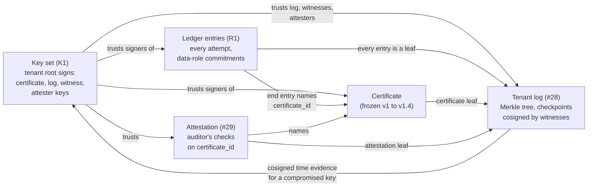

# Designs: trust around a certificate

> **Design only.** The owner approved writing these designs on 2026-11-16. Nothing in this folder is
> a spec, no verifier or issuer implements any of it, and no third party has been contacted. Each
> design ends with the questions the owner decides before anything is built.

A decision certificate's signature shows who signed it and that it was not altered (spec §3). It
does not show that the signer's key was still trusted when it signed, that the operator showed every
attempt, that nothing rewrote the record, or that anyone else checked the measurement. These four
designs cover those gaps:

| Design | Question it answers | Tracking |
|---|---|---|
| [K1: key revocation and rotation](k1-key-revocation-rotation.md) | Was this key trusted for this certificate, and what happens when a key is retired or leaks? | v1.3 draft, K1 |
| [R1: the issuance ledger](r1-issuance-ledger.md) | How many attempts were made on these cases, and were the certification cases used for anything else? | v1.3 draft, R1 |
| [Transparency log](transparency-log.md) | Can the operator rewrite or hide what it recorded? | #28 |
| [Auditor countersignature](auditor-countersignature.md) | Did someone other than the operator check the measurement, and what exactly did they check? | #29 |

## Rules all four follow

**Frozen certificates stay as they are.** v1 to v1.4 certificates, their fixtures and their
verdicts do not change. `certificate_id` is a frozen identity
([ERRATA, 2026-11-15](../../spec/ERRATA.md)), and every design names a certificate by it. A design
adds either a separate signed document that refers to a certificate by `certificate_id` (a
*sidecar*), or a field in a later `spec` value. None of them adds a field to a frozen spec.

**Tenant-only (owner, 2026-11-16).** A tenant's certificates, histograms included, are visible only
inside that tenant's scope. The tenant may export them to its own auditor. There is no cross-tenant
and no public view. Here a *tenant* is the operator on whose behalf certificates are issued; a
self-hosting operator is its own tenant. So every ledger, log, key set and attestation below belongs
to one tenant and is held in that tenant's scope. Nothing about a tenant's certificates is
published, and anything that leaves the scope is named in the design that sends it.

**Offline verification.** The verifiers never call a network service. Everything a consumer checks
travels with the certificate (in an evidence pack, whose format is designed separately) or is part
of the consumer's configuration, as the trusted keys are today.

**New documents, separate signatures.** Each new document kind has its own `spec` string, is
canonicalised with RFC 8785 (JCS), and is signed with Ed25519, verified strictly as certificates
are (spec v1.2 §3). The signed bytes are an ASCII context string, a newline (0x0A), then the JCS
bytes of the document without `signature`:

| Document | Context string |
|---|---|
| key set (K1) | `decision-cert/keyset.v1` |
| ledger entry (R1) | `decision-cert/ledger-entry.v1` |
| attestation (#29) | `decision-cert/attestation.v1` |
| log checkpoint (#28) | the C2SP signed-note format, which has its own framing |

A certificate's signed bytes are bare JCS and so begin with `{`. A context string begins with `d`.
So no signature over a new document can verify as a certificate's, or the reverse, even when one key
signs both. A document's hash, where another document refers to it, is `sha256:` + hex SHA-256 of
the JCS bytes of the whole signed document, `signature` included: the same rule as
`certificate_id`.

**Wording.** Every document here describes a measured process or a recorded event. None promises an
outcome, and a certificate never guarantees an outcome.

## How they fit

The suggested order, if the owner approves building any of it: K1's key set first, since the other
three need keys with roles; then R1 as a local ledger; then the tenant log, which anchors the ledger
and gives K1 its independent time; then attestations, which can check all three.
